# Near-Circle-Friend (Ni-Ce-Friend)

**A Proposed Facebook Messenger Feature**

*Discover nearby friends. Reconnect in real life.*

Near-Circle-Friend helps existing friends rediscover opportunities for real-world connection. Its Messenger-inspired interface combines an interactive proximity radar (real PostgreSQL/PostGIS distance and bearing math over a simulated Metro Manila dataset) with **Reconnect Today** candidates and on-demand meetup advice genuinely inferred by Muse Spark 1.3 — never hardcoded, never simulated.

> Independent prototype built for the **Meta Global AI Hackathon 2026**. Not an officially released, endorsed, or integrated Facebook or Messenger feature. All identities, conversations, and locations are simulated; the proximity math, routing, and AI inference are real.

## Section 1 — Quick Start for Hackathon Judges

### Prerequisites

- Git.
- Node.js 20 or newer.
- npm (ships with Node.js).
- Docker Desktop or Docker Engine, running.
- Docker Compose v2 (included with Docker Desktop).
- Your own authorized Meta Model API credentials (the judge's key — the repository never ships one).

### Clone

```powershell
git clone https://github.com/orq0/near-circle-friend.git
cd near-circle-friend
```

### Configure

Create `.env` from the template with the platform-appropriate command:

```powershell
# Windows PowerShell
Copy-Item .env.example .env

# macOS / Linux
cp .env.example .env
```

Then add your own credentials and confirm the AI budget. Required configuration:

```dotenv
MODEL_API_KEY=YOUR_OWN_META_API_KEY
AI_CIRCLE_MAX_TOKENS=2048
AI_CIRCLE_REASONING_EFFORT=low
```

- `MODEL_API_KEY` is **mandatory** for `npm run start:judges`: without it the bootstrap stops with setup instructions and starts nothing. Obtain it through authorized Meta Model API access. Never commit your `.env`.
- `npm run start:judges` generates `.env` from `.env.example` when it is missing, and never overwrites an existing one.

### Start

```powershell
npm run start:judges
```

This one command prepares application dependencies (`npm ci`, first run only), builds Docker images from the existing Dockerfiles, starts services with the existing Compose architecture (no volume resets, no destructive cleanup), runs the idempotent demo seed, and waits for real readiness: PostgreSQL health, API `/health`, frontend reachability, plus a 500 m discovery probe proving Coleen is seeded.

### Open

```text
http://localhost:5173
```

The script prints the actual URLs on success and opens the app in your browser (best-effort). API health: `http://localhost:3001/health`.

### Quick Demonstration

1. Open Near-Circle-Friend.
2. Explore the Radar — nearby opted-in friends appear as dots positioned by real distance and bearing.
3. Switch between 500 m, 1 km, 2 km, and 5 km and watch the set grow (Coleen → Alex → Sam → Rhea).
4. Open Reconnect Today — Coleen appears at all four distances.
5. Explore Rhea's card at 5 km.
6. Examine a friend profile: closeness tier, evidence, and provenance labels.
7. Trigger Ask Meta AI for genuine Muse Spark 1.3 meetup advice (requires your `MODEL_API_KEY`).
8. Open a walking route to see real OSRM pedestrian geometry (requires the one-time graph bootstrap below).

Short troubleshooting and the developer commands live in [Section 9 — Developer Guide](#section-9--developer-guide); the full judges reference (auto vs manual setup, AI/routing status meanings) is preserved there as well.

### Isolated test mode (never touches development Docker resources)

To exercise the full judge workflow without disturbing a running development stack:

```powershell
npm run start:judges -- --test
```

Test mode uses Compose project `near-circle-judges-test` with renamed containers, test-specific image tags (`:judges-test`), its own named volume, and separate host ports (app http://localhost:5273, API http://localhost:3101, PostgreSQL localhost:5533). Before creating anything it snapshots development container/image IDs, verifies the rendered Compose config contains no development names, reuses up-to-date test images (building only what is missing), and refuses to seed unless the connection target is the isolated database. It reports before/after evidence that development resources are unchanged. Your `.env` is read, never modified, and `MODEL_API_KEY` is never printed.

Stop only the test environment (volumes preserved by default):

```powershell
npm run stop:judges-test
npm run stop:judges-test -- --volumes   # also remove the isolated test volumes
```

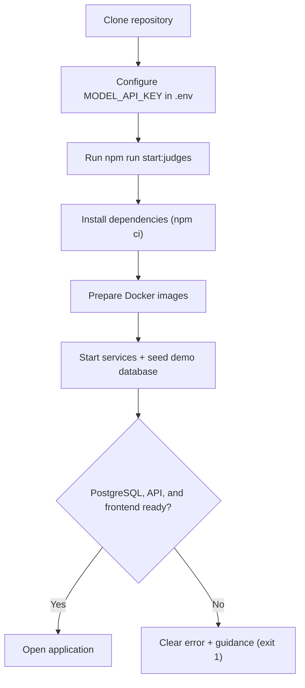

## Section 2 — Customer Journey: From Online Friendship to Real-World Connection

Screenshots captured from the running application (simulated identities, genuine proximity math, routing, and AI inference).

### 01 — Discover Nearby Friends

Open Near-Circle from the Messenger-style inbox and see who is actually nearby.

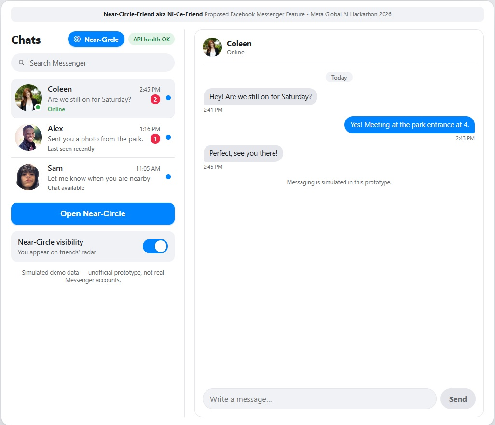

*The inbox you already know: existing conversations, a Near-Circle entry point, and an opt-in visibility toggle ("You appear on friends' radar"). Conversations are simulated; proximity comes from the live API.*

### 02 — Explore the Nearby Friends Radar

Adjust the discovery radius and watch the radar respond with real PostGIS distances.

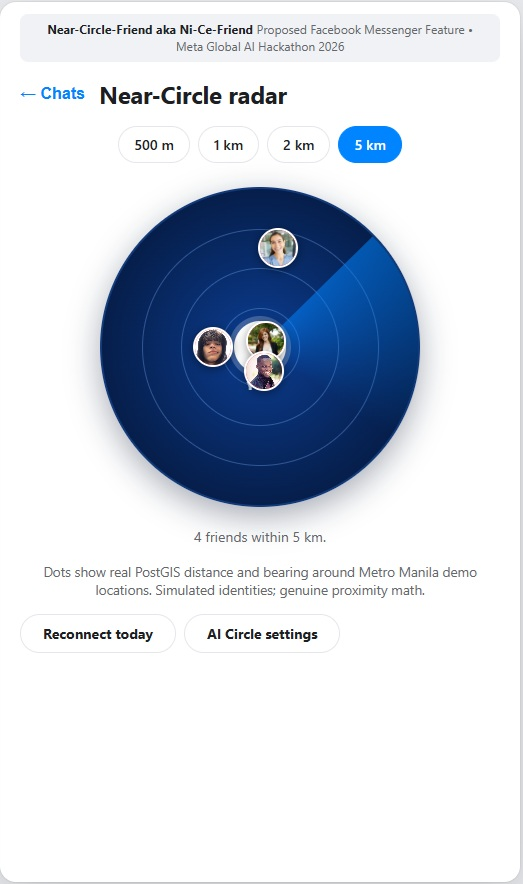

*Dots are placed by true distance and bearing around Metro Manila demo locations. The eligible set grows with the radius — Coleen at 500 m, Alex at 1 km, Sam at 2 km, Rhea at 5 km. The **Reconnect today** button carries the same radius into the candidate list.*

### 03 — Reconnect Today

Eligible nearby friends appear as reconnection candidates with stored closeness context.

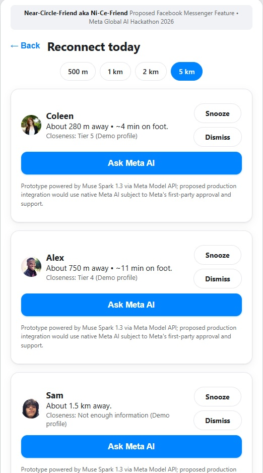

*Each card shows verified proximity ("About 280 m away · ~4 min on foot"), closeness tier and provenance ("Tier 5 (Demo profile)"), Snooze/Dismiss controls, and an explicit **Ask Meta AI** action. Candidacy applies the same backend rules as the radar — friendship, visibility, proximity, suppression — nothing is bypassed.*

### 04 — Control AI Participation

AI Circle settings keep every inference permission visible and reversible.

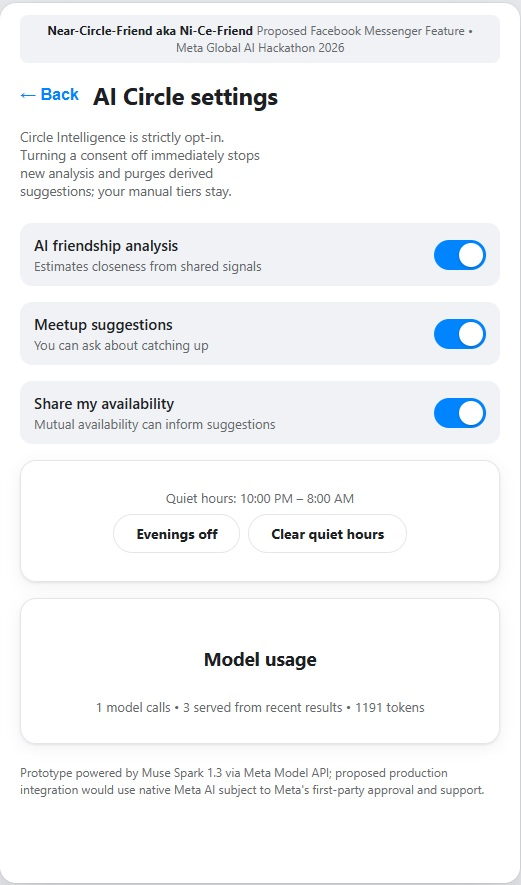

*Analysis and meetup-suggestion consents, availability sharing, and quiet hours are separate toggles; **Model usage** discloses calls, cache hits, and tokens. Turning a consent off immediately stops new analysis and purges derived suggestions.*

### 05 — Understand Friendship Context, Then Ask

Review the stored Circle Insight, then explicitly request assistance.

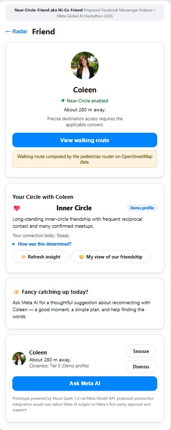

*The friend card confirms proximity and consent state; **Your Circle with Coleen** shows the persisted Inner Circle profile, connection trend, and how it was determined — all without invoking the model. Only the **Ask Meta AI** action ("Fancy catching up today?") triggers inference.*

### 06 — Receive AI-Generated Meetup Advice

The backend assembles eligible facts and Muse Spark 1.3 responds — with a suggestion or an honest abstention.

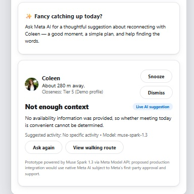

*This genuine result shows the abstention path: "Not enough context", labeled **Live AI suggestion** with `Model: muse-spark-1.3`. No availability was provided, so no meeting is recommended and no activity is invented. **Ask again** and **View walking route** keep the next step with the user. When context suffices, the same panel presents the suggested activity, reasoning, and an editable invitation draft — never sent automatically.*

### 07 — Walk the Route and Reconnect

Plan the meetup over real pedestrian geometry; the decision stays with the users.

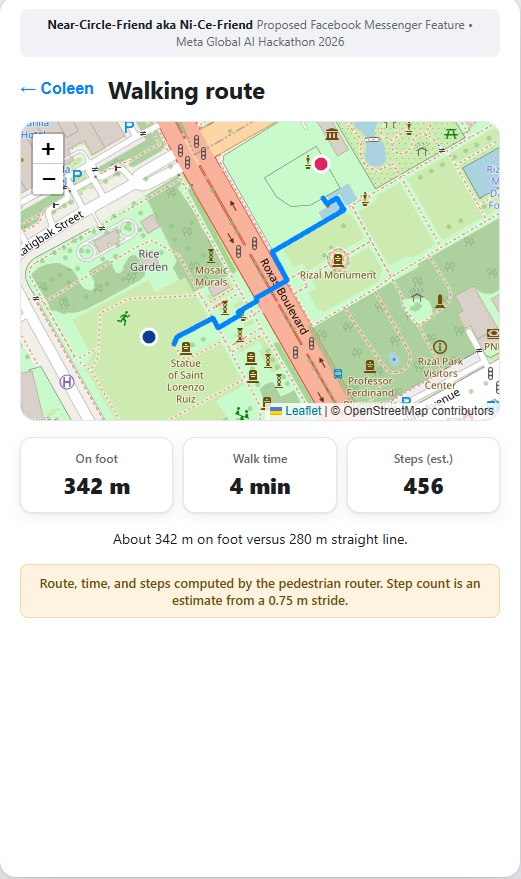

*OSRM foot routing near Rizal Park: 342 m on foot versus 280 m straight line, 4 minutes, ~456 steps. The prototype assists with discovery, planning, and invitation preparation — it never verifies a meetup occurred and never contacts anyone on your behalf.*

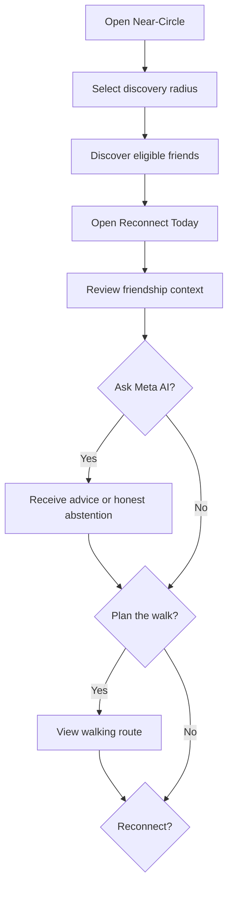

*Requesting AI advice and pursuing a meetup are both optional. Browsing never triggers inference; declining, snoozing, or dismissing a candidate is always one tap away.*

#### AI-assisted reconnection, step by step

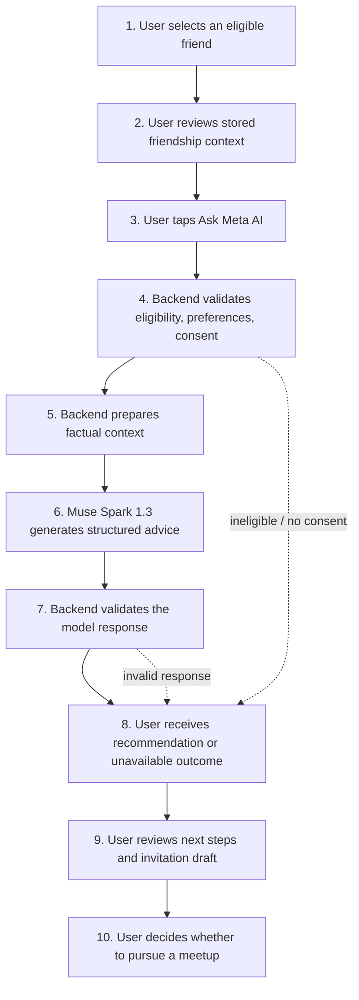

*Branches converge on step 8: success, insufficient context, restriction, and service failure all render as their own honest states — inference is never faked.*

## Section 3 — What Is Near-Circle-Friend?

Online friendships go quiet not from lack of care but lack of occasion: you never learn that a close friend is ten minutes away. Proximity alone is not enough either — a nearby stranger is not a reason to meet, while a meaningful friendship deserves better than a generic "people near you" list.

Near-Circle-Friend works only with **existing friendships**, and only when both sides opt in. It combines verified closeness (who matters to you, privately estimated) with verified proximity (who is actually close right now), then lets an AI assistant help with the *how* — a good moment, a simple plan, help finding the words — while both people keep full control.

| Passive social connections | The Near-Circle experience |
|---|---|
| Endless feed of distant updates | The friends who are actually nearby, right now |
| "People you may know" strangers | Only approved, opted-in, existing friends |
| Pressure to respond instantly | Low-pressure, snoozable, dismissible suggestions |
| Opaque ranking | Provenance labels on every AI output |
| Location shared by default | Discovery off until you enable it; precise spots stay private |

## Section 4 — Core Features

### Nearby Friends Radar

You at the center; eligible friends as dots placed by real distance and bearing. Four radii (500 m, 1 km, 2 km, 5 km), proximity rings, tap-to-inspect, and an honest empty state when nobody is in range.

### Reconnect Today

The same eligible set as deterministic candidate cards — Coleen at every distance, Rhea joining at 5 km — each with stored closeness context and an optional **Ask Meta AI** action. Browsing never invokes the model.

### Social Context and Reconnection Signals

Circle Insight shows the persisted closeness tier (1–5), evidence quality, rationale, trend, and provenance (`AI estimate`, `Demo profile`, `Your choice`, or an honest `Not enough information`). Reads never trigger reassessment; overrides always win.

### AI-Generated Meetup Advice

On-demand Muse Spark 1.3 suggestions with pre- and post-inference eligibility checks, consent gates, quiet hours, rate limits, short-lived caching, and editable invitation drafts that are never sent.

### Privacy and Eligibility Controls

Visibility toggle, per-friend discovery state, location freshness, approved-friendship checks, dismiss/snooze suppression, and separate analysis/advice consents that purge derived data on revocation.

### Demo Profiles and Synthetic Availability

Clearly labeled seed fixtures (including fictional Asia/Manila availability windows for the judging roster, used as model input context only) keep the demo meaningful without real user data.

### Realistic Profile Pictures

Fictional demo avatars with initial fallbacks across inbox, radar, cards, and panels.

### Optional Pedestrian Routing

OSRM foot-profile routes over Metro Manila OpenStreetMap data with distance, duration, and step estimates — reported `not-ready` (never faked) until the one-time graph bootstrap runs.

## Section 5 — System Architecture

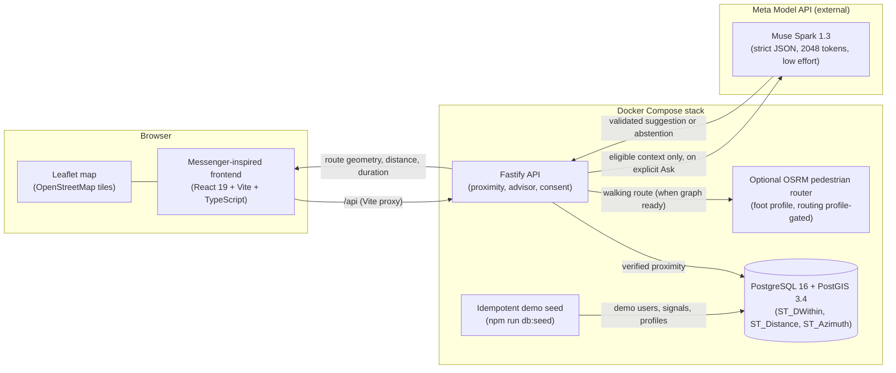

- **PostGIS** determines which eligible friends are nearby.
- **OSRM** calculates pedestrian routes over actual road and walkway networks.
- **Leaflet** visualizes routes on OpenStreetMap.
- **Muse Spark 1.3** is invoked only on explicit request, with aliased bucketed facts and a strict JSON contract; every output is validated before storage or display.
- The **frontend** presents discovery and navigation through a Messenger-inspired interface.

Near-Circle is self-contained: it does not depend on unrelated repositories or routing services, and it never contacts production Facebook or Messenger infrastructure.

## Section 6 — How Meta AI Works

Near-Circle-Friend does not hardcode AI recommendations. When you explicitly ask, the backend assembles factual context from eligible user information and invokes the actual Meta Model API — then validates the structured reply before anything is stored or shown.

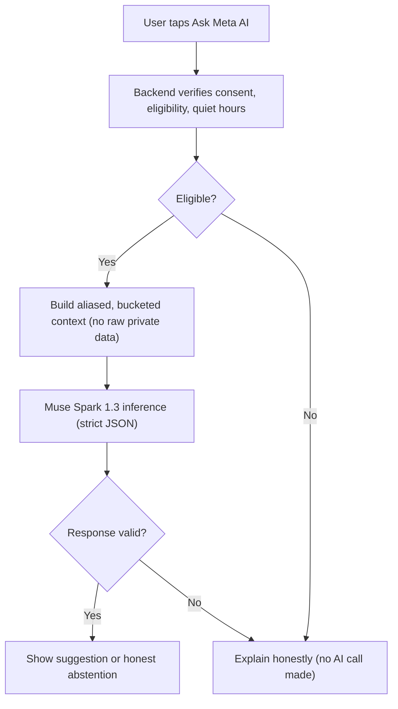

Deterministic application checks (consent, eligibility, budgets, cache) always run first; generative inference runs last and only on demand. Failure paths — ineligible friend, missing consent, quiet hours, exhausted budget, unreachable model, invalid response — each render as their own honest UI state.

- Model: `muse-spark-1.3`.
- Completion budget: 2048 by default.
- Reasoning effort: low by default.
- Strict structured outputs with response validation.
- Genuine live inference (presence of a key is not proof — only a real call is).
- Synthetic demo data is input context only, never presented as a live result.

No credentials or internal reasoning content are ever displayed, and no request is guaranteed a positive recommendation — `later` and `insufficient_context` are first-class outcomes.

## Section 7 — Privacy, Consent, and Discovery Eligibility

A friend appears only when every gate agrees. The proximity gates are enforced together inside the backend query; the advice path adds its own pre- and post-inference rechecks.

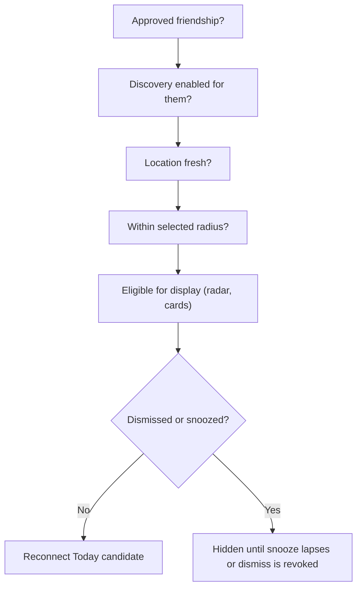

- **Approved friendship** — pending, blocked, and unknown friendships are invisible.
- **Discovery visibility** — each user opts in; turning Near-Circle off pauses everything.
- **Location freshness** — stale or missing locations never place a dot (30-day demo window).
- **Proximity eligibility** — real PostGIS distance within the selected radius.
- **Reconnect suppression** — dismiss hides until revoked; snooze hides until expiry; a declined invite only shapes future advice, never candidacy.
- **Quiet hours and consents** — advice additionally requires advice consent, out-of-quiet-hours timing, and per-user/per-friend budgets; revoking analysis or advice consent purges derived data immediately.

## Section 8 — Technology Stack

| Layer | Technology | Purpose |
|---|---|---|
| Frontend | React 19, TypeScript, Vite | Messenger-inspired UI, radar, cards, panels |
| Backend | Fastify, TypeScript | Health, proximity, friends, routes, AI advisor |
| Geospatial | PostgreSQL 16, PostGIS 3.4 | Proximity queries, distance, bearing |
| AI | Meta Model API, Muse Spark 1.3 | On-demand meetup advice with strict validation |
| Routing | OSRM foot profile (optional) | Pedestrian geometry, duration, steps |
| Maps | Leaflet, OpenStreetMap | Route rendering (external tiles) |
| Infrastructure | Docker Compose | Local orchestration of db, api, web (+ routing profile) |

## Section 9 — Developer Guide

### Developer setup

```powershell
git clone https://github.com/orq0/near-circle-friend.git
cd near-circle-friend
Copy-Item .env.example .env   # cp .env.example .env on macOS/Linux
npm install
npm run db:seed               # idempotent Metro Manila demo dataset
npm run startall              # Compose stack with real readiness waits
```

### Commands

| Command | Effect |
|---|---|
| `npm run startall` | Start the Compose stack and wait for real readiness; enables the routing profile automatically once the graph exists |
| `npm run start:judges` | Judge bootstrap: install, env, images, seed, and readiness in one command |
| `npm run start:judges -- --test` | Isolated test run (separate project, containers, volume, ports) |
| `npm run stop:judges-test` | Stop only the isolated test run (volumes preserved; add `-- --volumes` to remove them) |
| `npm run status` | Read-only health of every service (never prints secrets) |
| `npm run stopall` | Stop project services only; preserves data and graphs |
| `npm run dev:api` | Native fallback: Fastify with reload on <http://localhost:3001> |
| `npm run dev:web` | Native fallback: Vite with HMR on <http://localhost:5173> |

Default URLs: web <http://localhost:5173/>, API health <http://localhost:3001/health>, router <http://localhost:5002>, PostgreSQL `localhost:5433`.

### One-time pedestrian graph bootstrap

The router is gated behind the `routing` Compose profile until its graph is prepared. This takes a few minutes and ~2 GB of disk (the Manila PBF is downloaded once into `routing/data/`, validated, and reused on later runs):

```powershell
pwsh -NoProfile -ExecutionPolicy Bypass -File ./routing/prepare-graph.ps1
npm run startall   # routing profile enables automatically once the graph exists
npm run status     # expect near-circle-routing-walk: healthy
```

Data provenance: Metro Manila extract from BBBike (© OpenStreetMap contributors, ODbL). See [`routing/README.md`](./routing/README.md) for details, the direct API test, and the Geofabrik fallback.

### API endpoints

| Endpoint | Purpose |
|---|---|
| `GET /health` | Service health |
| `GET /friends/nearby?radius_m=1000` | Eligible nearby friends with distance and bearing |
| `GET /near-circle/visibility` | Activation state |
| `PUT /near-circle/visibility` | Enable/disable (+ optional radius) |
| `POST /near-circle/toggle` | Enable/disable alias |
| `PUT /location` | Move the demo user (simulated) |
| `GET /friends` | Approved friends with Near-Circle/location status |
| `GET /friends/:id` | Friend detail; proximity only when discoverable |
| `GET /friends/:id/route` | Pedestrian route (geometry, distance, duration, steps) |
| `GET /ai-circle/settings` · `PUT /ai-circle/settings` | AI consents, availability sharing, quiet hours (revoke purges derived data) |
| `GET /ai-circle/closeness/:friendId` | Stored closeness view (reads never invoke the model) |
| `POST /ai-circle/closeness/:friendId/assess` | Request (re)assessment; returns 202, processed by the bounded in-process job runner |
| `PUT /ai-circle/closeness/:friendId` | Manual tier override (`level` 1–5) or clear (`null`) |
| `GET /ai-circle/opportunities?radius_m=` | Deterministic nearby candidates with stored closeness and optional walk minutes |
| `POST /ai-circle/opportunities/:friendId/advise` | On-demand meetup advice with pre/post authorization, cache, and budgets |
| `POST /ai-circle/feedback` | Dismiss / snooze / declined-invite feedback |
| `GET /ai-circle/usage` | Privacy-safe inference counters (requests, cache, tokens, rate limits) |

### Project structure

```text
apps/web/          # React + Vite + TS Messenger-inspired UI (mock conversations in src/mockData.ts)
apps/api/          # Fastify API: health, nearby/visibility/location/friends/route (PostGIS + OSRM)
db/init/           # PostGIS extension + schema
db/seed/           # Idempotent Metro Manila demo dataset (npm run db:seed)
db/cleanup/        # One-shot demo-data corrections (explicit host execution only)
routing/           # OSRM boundary: README, data/ (graph artifacts), prepare-graph.ps1
scripts/           # startall.ps1 / stopall.ps1 / status.ps1 (+ common.ps1), judges.mjs bootstrap
docs/              # Specs and screenshots
docker-compose.yml # Four project-owned services
docker-compose.judges-test.yml # Isolated test-mode overlay (renamed containers/images/volume)
```

### Testing and verification

```powershell
npm run typecheck   # TypeScript across API and web workspaces
npm run build       # Type-check + production builds
npm test            # Unit tests (API and web)
```

Live integration tests (require a seeded stack and, for routing, the prepared graph):

```powershell
npm run db:seed
$env:RUN_INTEGRATION_TESTS='1'; npm --workspace apps/api run test:integration   # 6 PostGIS + 1 routing + 2 live-AI (skip without MODEL_API_KEY)
```

See [`.env.example`](./.env.example) for configurable ports, credentials, routing endpoints, and map-tile URLs.

### Demo fixtures

The seed adds Jamie (frequent recent contact, beyond 5 km so existing discovery expectations are unchanged) and Taylor (discovery opt-out), plus Alex's persisted Level-4 demo profile and Sam's sparse "not enough information" profile. Enable the two consents in **AI Circle settings**, open **Reconnect today**, and judge the abstain/suggest flows end to end keyless.

### Known limitations

- All identities, conversations, friendships, and demo locations are simulated. There is no Facebook login, no real friend graph, and no real messaging.
- The demo context is a single local user (`you` near Rizal Park); there is no authentication system.
- Walking routes require the one-time graph bootstrap above; before it, the route screen honestly reports unavailability rather than fabricating geometry.
- Step counts are estimates from walking distance and a configurable stride (default 0.75 m), not measured steps.
- Map tiles come from an external OSM-compatible provider, not from a local container.
- Location freshness is demo-driven (30-day window); consent checks are enforced in the API but there is no real account system behind them.
- AI assessments and advice bill against your Meta Model API key and rate limits; without a key the feature serves stored fixtures and deterministic labeled demo advice. AI outputs are suggestions grounded in disclosed facts, not measured truth — manual tiers always win.

### Troubleshooting

- **Router shows `not-ready`:** Expected until the graph bootstrap has run; core services start without OSRM. See the bootstrap section above.
- **Docker missing:** `startall` reports an actionable error; use `npm run dev:api` and `npm run dev:web` for native web/API development.
- **Port conflict:** Configure `WEB_PORT`, `API_PORT`, `POSTGRES_PORT`, or `ROUTING_WALK_PORT` in `.env`. Port 5001 is avoided deliberately (commonly occupied by unrelated OSRM instances); the project router uses 5002.
- **npm `EPERM` on cache (locked-down profiles):** Run `$env:npm_config_cache = "$PWD\.npm-cache"; npm install`.
- **Tile outage:** Map tiles are external; `npm run status` reports their reachability as `unknown` when offline, and the app never misrepresents unavailable routing as working.

## Section 10 — Additional Documentation Links

- [`routing/README.md`](./routing/README.md) — pedestrian graph bootstrap, direct API test, Geofabrik fallback.
- [`.env.example`](./.env.example) — every knob: ports, credentials, model, timeouts, budgets, routing endpoints, tiles.
- [`docs/screenshots/`](./docs/screenshots/) — application screenshots used above.
- [`docs/Near-Circle-Friend_Mission_Statement_Visual.pdf`](./docs/Near-Circle-Friend_Mission_Statement_Visual.pdf) — mission statement (visual).

*Attribution: Near-Circle-Friend is an independent hackathon project built for the Meta Global AI Hackathon 2026. The proposed Messenger integration is conceptual; this is not an officially released Facebook or Messenger feature, and no Meta endorsement is claimed. Map data © OpenStreetMap contributors (ODbL); the Metro Manila extract is sourced from BBBike. Any future integration with Facebook platforms would depend on the relevant APIs, permissions, and approvals.*
