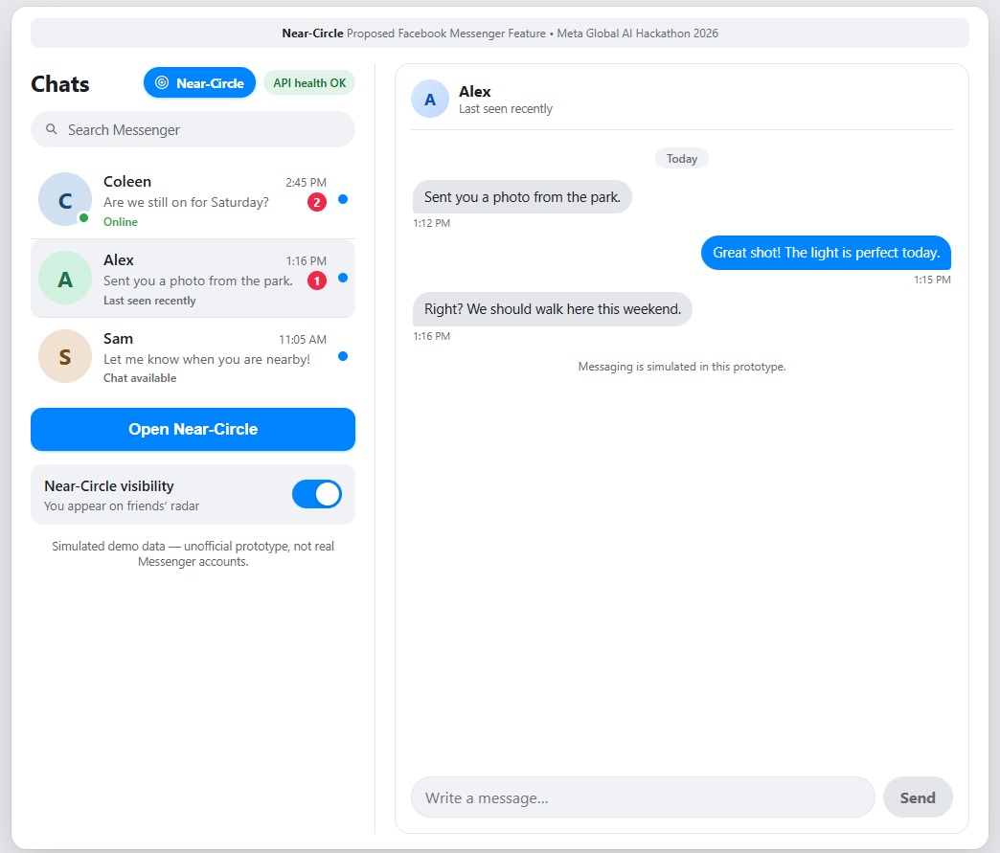
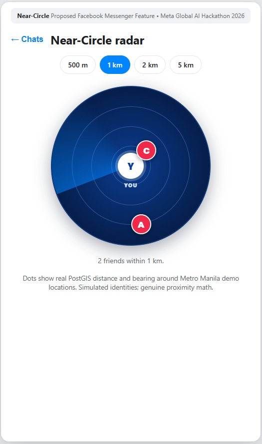
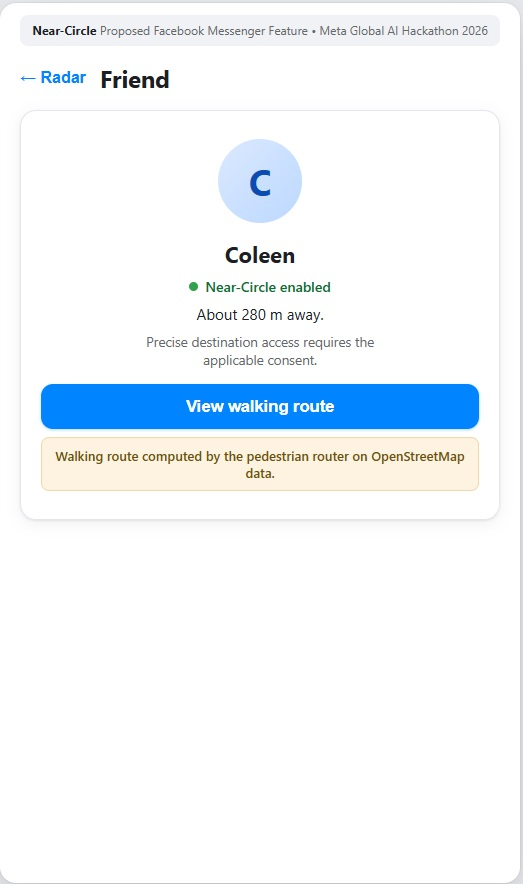
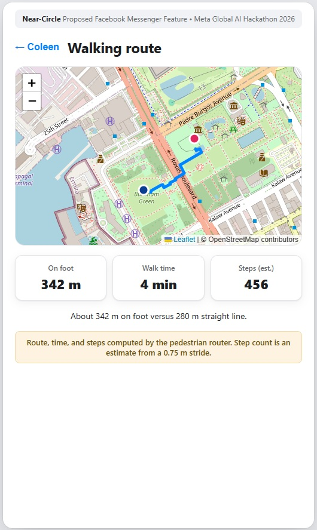
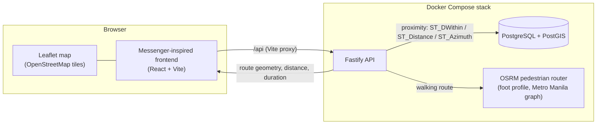

# Near-Circle-Friend aka Ni-Ce-Friend

**Proposed Facebook Messenger Feature • Meta Global AI Hackathon 2026**

*Discover nearby friends. Reconnect in real life.*

Near-Circle-Friend, also known as **Ni-Ce-Friend**, is a proximity-based social discovery application demonstrating how Facebook Messenger could help friends reconnect in the real world. Its Messenger-inspired interface combines an interactive proximity radar, geospatial discovery powered by PostgreSQL/PostGIS, and pedestrian navigation using OSRM and OpenStreetMap.

Users can discover nearby participating friends, explore their proximity on the **Near-Circle** radar, and view actual walking routes with estimated travel times and step counts.

Ni-Ce-Friend is an independent concept prototype developed for the Meta Global AI Hackathon 2026. It is not an officially released, endorsed, or integrated Facebook or Messenger feature.

## Project Overview

| | |
|---|---|
| Official project identity | Near-Circle-Friend aka Ni-Ce-Friend |
| Short product name | Ni-Ce-Friend |
| Proximity discovery feature | Near-Circle |
| Repository | near-circle-friend |
| Positioning | Proposed Facebook Messenger Feature |
| Event | Meta Global AI Hackathon 2026 |
| Tagline | *Discover nearby friends. Reconnect in real life.* |

**Project references:** [`Near-Circle_Dev_Plan.md`](./Near-Circle_Dev_Plan.md) is the authoritative technical specification; [`Near-Circle_Dev_Plan_visual.pdf`](./Near-Circle_Dev_Plan_visual.pdf) is the visual and UX reference.

## Key Features

### Messenger-Inspired Experience

- Familiar messaging interface with simulated conversations.
- Functional conversation search that filters the simulated chat list.
- A Near-Circle entry point in the inbox header, alongside the main **Open Near-Circle** action.
- Responsive desktop and mobile presentation.

### Interactive Proximity Radar

- The current user sits at the center; nearby opted-in friends appear as red dots.
- Concentric proximity rings, a configurable discovery radius (500 m / 1 km / 2 km / 5 km), and friend selection.
- Friend dots are positioned from real geographic distance and bearing calculations.
- Opt-in visibility controls: turning Near-Circle off pauses discovery.

### Real Geospatial Discovery

- PostgreSQL/PostGIS proximity queries using `ST_DWithin` over geography points.
- Geodesic distance (`ST_Distance`) and bearing (`ST_Azimuth`) calculations with spatial indexing.
- Friend-relationship eligibility filtering: only approved, opted-in friends with fresh locations are returned.
- A simulated Metro Manila demo dataset (identities and conversations are fictional; the geospatial math is real).

### Pedestrian Navigation

- OSRM pedestrian (foot profile) routing over a Metro Manila OpenStreetMap graph.
- Interactive Leaflet map rendering the actual route geometry.
- Walking distance, estimated duration, and estimated step counts from a configurable stride.
- On-foot distance is always shown alongside the straight-line distance — never conflated.

### AI Circle Intelligence

- Friendship closeness estimates from coarse, consented aggregates (tiers 1–5 plus honest "Not enough information").
- **Circle Insight** on each friend card: level, evidence quality, rationale, trend, and provenance.
- **Reconnect today** screen with deterministic nearby candidates and per-friend **Ask Meta AI**.
- Editable invitation drafts that are never sent; low-pressure suggestions only.
- Strictly opt-in: analysis and advice consents default off; revoking purges derived data.
- Every AI surface carries an explicit provenance label — live estimate, recent result, demo profile, or your choice.

## Application Screenshots

Captured from the running application (Messenger-inspired interface, live PostGIS radar, and real OSRM routing):

### Messenger Experience



### Interactive Proximity Radar



### Nearby Friend Discovery



### Pedestrian Navigation



## How Ni-Ce-Friend Works

1. The Messenger-inspired frontend (`apps/web`) calls the Fastify API (`apps/api`).
2. For discovery, the API runs PostGIS queries in PostgreSQL: it computes the demo user's position, finds approved friends with Near-Circle enabled and fresh locations within the radius, and returns each friend's distance and bearing.
3. The frontend places those friends as dots on the Near-Circle radar.
4. When a friend is selected, the API asks the OSRM pedestrian router for a walking route over the Metro Manila road/walkway network and returns the route geometry, distance, and duration.
5. Leaflet renders the route on OpenStreetMap; the UI adds estimated steps (distance ÷ stride) and compares walking distance with the straight line.

## Technical Architecture

| Component | Technology |
|---|---|
| Frontend | React 19, TypeScript, Vite |
| Backend | Fastify, TypeScript |
| Database | PostgreSQL 16 |
| Geospatial engine | PostGIS 3.4 |
| Pedestrian routing | OSRM (foot profile) |
| Map rendering | Leaflet |
| Map data | OpenStreetMap |
| Infrastructure | Docker Compose |



- **PostGIS** determines which eligible friends are nearby.
- **OSRM** calculates pedestrian routes over actual road and walkway networks.
- **Leaflet** visualizes routes on OpenStreetMap.
- The **frontend** presents discovery and navigation through a Messenger-inspired interface.

Near-Circle is self-contained: it does not depend on unrelated repositories or routing services.

## Installation and Setup

### Prerequisites

- Windows 11 with PowerShell 7 (`pwsh`) or Windows PowerShell 5.1.
- Node.js 20+ and npm.
- Docker Desktop (for the Compose stack; the web and API can also run natively).

### Quickstart

```powershell
git clone https://github.com/orq0/near-circle-friend.git
cd near-circle-friend

# Optional environment overrides (defaults already work)
Copy-Item .env.example .env

# Dependencies
npm install

# Seed the Metro Manila demo dataset into the database (idempotent)
npm run db:seed

# Start the project services
npm run startall

# Open the app
# http://localhost:5173/
```

### Quick Start for Hackathon Judges

One command prepares everything (prerequisites below must already be installed):

```powershell
git clone https://github.com/orq0/near-circle-friend.git
cd near-circle-friend
npm run start:judges
```

What the script installs and prepares automatically:

- Application dependencies via `npm ci` (first run only; reused afterwards).
- A local `.env` generated from `.env.example` when missing (an existing `.env` is never overwritten).
- Docker images via `docker compose build` using the existing Dockerfiles.
- Service startup via the existing Compose architecture (no volume resets, no destructive cleanup).
- Idempotent demo seeding (`npm run db:seed`; safe to re-run, never duplicates records).
- Readiness checks: PostgreSQL health, API `/health`, frontend reachability, and a 500 m discovery probe proving Coleen is seeded.

What you must provide yourself (the script never installs or provisions these):

- Node.js 20+ and npm — https://nodejs.org/
- Docker Desktop (or Docker Engine) running — https://www.docker.com/products/docker-desktop/
- Your own authorized Meta Model API key for live inference: set `MODEL_API_KEY=<YOUR_OWN_META_API_KEY>` in `.env`. The key is mandatory — `npm run start:judges` stops with setup instructions when it is missing (nothing starts, nothing is simulated as `meta_live`). The repository never ships a credential and `.env` is never committed.
- Optional pedestrian-routing data (see "One-time pedestrian graph bootstrap" below); routing reports `not-ready` without it and the core app is unaffected.

On success the script prints the actual URLs (defaults: app http://localhost:5173/, API http://localhost:3001/health), the AI status (Configured — key presence only; authentication is proven solely by a real inference call such as Ask Meta AI), and the routing status, and opens the app in your browser (best-effort).

Demo in 30 seconds: open Radar → select 500 m → open Reconnect Today (Coleen appears) → select a friend dot → ask Meta AI for a meetup suggestion.

Stop services any time (volumes preserved):

```powershell
npm run stopall
```

Troubleshooting:

- `Docker Engine running [FAIL]` — install/start Docker Desktop, then re-run.
- A port conflict — stop the unrelated process or set `WEB_PORT`, `API_PORT`, or `POSTGRES_PORT` in `.env`.
- `Demo users seeded [FAIL]` — run `npm run db:seed` manually and check the API logs.
- `Live AI credentials configured [FAIL]` — add your own `MODEL_API_KEY` to `.env` (never commit it) and re-run; the bootstrap changes nothing until the key is present.
- Repeat runs are safe: healthy services are reused, seeding is idempotent, and no volumes are ever reset.

### One-time pedestrian graph bootstrap

The router is gated behind the `routing` Compose profile until its graph is prepared. This takes a few minutes and ~2 GB of disk (the Manila PBF is downloaded once into `routing/data/`, validated, and reused on later runs):

```powershell
pwsh -NoProfile -ExecutionPolicy Bypass -File ./routing/prepare-graph.ps1
npm run startall   # routing profile enables automatically once the graph exists
npm run status     # expect near-circle-routing-walk: healthy
```

Data provenance: Metro Manila extract from BBBike (© OpenStreetMap contributors, ODbL). See [`routing/README.md`](./routing/README.md) for details, the direct API test, and the Geofabrik fallback.

## Running the Application

| Command | Effect |
|---|---|
| `npm run startall` | Start the Compose stack and wait for real readiness; enables the routing profile automatically once the graph exists |
| `npm run status` | Read-only health of every service (never prints secrets) |
| `npm run stopall` | Stop project services only; preserves data and graphs |
| `npm run dev:api` | Native fallback: Fastify with reload on <http://localhost:3001> |
| `npm run dev:web` | Native fallback: Vite with HMR on <http://localhost:5173> |

Default URLs: web <http://localhost:5173/>, API health <http://localhost:3001/health>, router <http://localhost:5002>, PostgreSQL `localhost:5433`.

## Demo Walkthrough

For hackathon judges — helping friends reconnect through proximity-aware social discovery:

1. Open Ni-Ce-Friend's Messenger-inspired interface at <http://localhost:5173>.
2. Browse the simulated conversations (Coleen, Alex, Sam).
3. Launch **Near-Circle** from the header or the **Open Near-Circle** button.
4. Make sure proximity discovery is activated (the visibility toggle in the inbox).
5. Watch nearby friends appear as red dots on the radar — Coleen at ~280 m at the default 1 km radius.
6. Adjust the discovery radius (500 m → 1 km → 2 km → 5 km) and watch dots appear (Alex, Sam, then Rhea).
7. Select a nearby friend dot.
8. Review the proximity information (real computed distance).
9. Open **View walking route** for pedestrian navigation.
10. See the real OSRM walking route on OpenStreetMap with distance, ETA, and estimated steps.
11. Return to the radar or the Messenger inbox with the back controls.

## AI Circle Intelligence

Prototype powered by Muse Spark 1.3 via Meta Model API; proposed production integration would use native Meta AI subject to Meta's first-party approval and support.

AI Circle Intelligence adds friendship closeness and low-pressure meetup guidance on top of discovery — without ever replacing the deterministic PostGIS/OSRM facts. Closeness comes from coarse consented aggregates only (known-for, recency, frequency, reciprocity, confirmed meetups, declared values). No message bodies, post text, personal identifiers beyond the demo pair, or precise locations ever reach the model: its prompts contain aliased, bucketed facts with a strict JSON contract, and every output is validated before storage or display.

**Consent and honesty model.** New analysis and advice consents default off. Reassessments run only for approved initial or materially changed and consented friendships, with a 14-day cooldown, hysteresis against signal flicker, and a bounded retry budget. Advice requires advice consent, eligibility rechecks before and after inference, and per-user/per-friend rate limits. Turning consent off immediately cancels queued work and purges derived suggestions (manual tiers are never auto-replaced and survive revocation). Map, radar, and walking routes keep working when the model is unreachable.

**Provenance labels.** `AI estimate` = persisted from live Muse Spark inference; `Recent AI suggestion`/`Live AI suggestion` = freshly computed or cached results; `Demo profile`/`Demo suggestion` = clearly labeled seed fixtures; `Your choice` = manual override (always displayed first); `Not enough information` = abstention, never a guess.

**Setup.** The feature is enabled by default and degrades honestly without a key (reads work; advice returns labeled demo results). For live inference, set `MODEL_API_KEY` in your (never committed) `.env` — see the `AI Circle Intelligence` section of [`.env.example`](./.env.example) for the model name, base URL, timeout, cooldown, cache TTL, and budget knobs. The API container picks these up through Compose automatically.

**Demo fixtures.** The seed adds Jamie (frequent recent contact, beyond 5 km so existing discovery expectations are unchanged) and Taylor (discovery opt-out), plus Alex's persisted Level-4 demo profile and Sam's sparse "not enough information" profile. Enable the two consents in **AI Circle settings**, open **Reconnect today**, and judge the abstain/suggest flows end to end keyless.

## API Endpoints

| Endpoint | Purpose |
|---|---|
| `GET /health` | Service health |
| `GET /friends/nearby?radius_m=1000` | Eligible nearby friends with distance and bearing |
| `GET /near-circle/visibility` | Activation state |
| `PUT /near-circle/visibility` | Enable/disable (+ optional radius) |
| `POST /near-circle/toggle` | Enable/disable alias |
| `PUT /location` | Move the demo user (simulated) |
| `GET /friends` | Approved friends with Near-Circle/location status |
| `GET /friends/:id` | Friend detail; proximity only when discoverable |
| `GET /friends/:id/route` | Pedestrian route (geometry, distance, duration, steps) |
| `GET /ai-circle/settings` · `PUT /ai-circle/settings` | AI consents, availability sharing, quiet hours (revoke purges derived data) |
| `GET /ai-circle/closeness/:friendId` | Stored closeness view (reads never invoke the model) |
| `POST /ai-circle/closeness/:friendId/assess` | Request (re)assessment; returns 202, processed by the bounded in-process job runner |
| `PUT /ai-circle/closeness/:friendId` | Manual tier override (`level` 1–5) or clear (`null`) |
| `GET /ai-circle/opportunities?radius_m=` | Deterministic nearby candidates with stored closeness and optional walk minutes |
| `POST /ai-circle/opportunities/:friendId/advise` | On-demand meetup advice with pre/post authorization, cache, and budgets |
| `POST /ai-circle/feedback` | Dismiss / snooze / declined-invite feedback |
| `GET /ai-circle/usage` | Privacy-safe inference counters (requests, cache, tokens, rate limits) |

## Project Structure

```text
apps/web/          # React + Vite + TS Messenger-inspired UI (mock conversations in src/mockData.ts)
apps/api/          # Fastify API: health, nearby/visibility/location/friends/route (PostGIS + OSRM)
db/init/           # PostGIS extension + schema
db/seed/           # Idempotent Metro Manila demo dataset (npm run db:seed)
routing/           # OSRM boundary: README, data/ (graph artifacts), prepare-graph.ps1
scripts/           # startall.ps1 / stopall.ps1 / status.ps1 (+ common.ps1)
docs/              # Specs and screenshots
docker-compose.yml # Four project-owned services
```

## Testing and Verification

```powershell
npm run typecheck   # TypeScript across API and web workspaces
npm run build       # Type-check + production builds
npm test            # Unit tests (API and web)
```

Live integration tests (require a seeded stack and, for routing, the prepared graph):

```powershell
npm run db:seed
$env:RUN_INTEGRATION_TESTS='1'; npm --workspace apps/api run test:integration   # 6 PostGIS + 1 routing + 2 live-AI (skip without MODEL_API_KEY)
```

See [`.env.example`](./.env.example) for configurable ports, credentials, routing endpoints, and map-tile URLs.

## Known Limitations

- All identities, conversations, friendships, and demo locations are simulated. There is no Facebook login, no real friend graph, and no real messaging.
- The demo context is a single local user (`you` near Rizal Park); there is no authentication system.
- Walking routes require the one-time graph bootstrap above; before it, the route screen honestly reports unavailability rather than fabricating geometry.
- Step counts are estimates from walking distance and a configurable stride (default 0.75 m), not measured steps.
- Map tiles come from an external OSM-compatible provider, not from a local container.
- Location freshness is demo-driven (30-day window); consent checks are enforced in the API but there is no real account system behind them.
- AI assessments and advice bill against your Meta Model API key and rate limits; without a key the feature serves stored fixtures and deterministic labeled demo advice. AI outputs are suggestions grounded in disclosed facts, not measured truth — manual tiers always win.

## Hackathon Development and Attribution

- **Near-Circle-Friend aka Ni-Ce-Friend** is an independent hackathon project built for the Meta Global AI Hackathon 2026. The proposed Messenger integration is conceptual; this is not an officially released Facebook or Messenger feature, and no Meta endorsement is claimed.
- Social identities, conversations, and friendships in the demo are simulated. Proximity detection uses actual PostgreSQL/PostGIS computations; pedestrian navigation uses actual OSRM routing over OpenStreetMap data.
- Map data © OpenStreetMap contributors, available under the [ODbL](https://www.openstreetmap.org/copyright). The Metro Manila extract is sourced from BBBike; see [`routing/README.md`](./routing/README.md) for provenance and the fallback source.
- The project was developed across phases: (1) Messenger-inspired foundation and stack, (2) live PostGIS proximity radar, (3) OSRM pedestrian routing, (4) Messenger-fidelity presentation. Phases in progress: API hardening/validation, and submission packaging.
- Any future integration with Facebook platforms would depend on the relevant APIs, permissions, and approvals.

## Future Development

### AI-Powered Friendship Compass (proposed)

A proposed Meta AI capability that estimates friendship closeness from authorized interaction signals:

- Analyze consented interaction histories (initially simulated for the prototype).
- Estimate friendship-affinity levels from interaction frequency, recency, and reciprocity.
- Combine friendship affinity with walking proximity.
- Generate contextual meetup suggestions.

Meta AI cannot freely access private Messenger conversations or complete Facebook friendship data; this is future functionality, not implemented in the prototype.

### Additional Planned Features

- Approved Facebook authentication and permitted platform integration.
- Mutual meetup invitations and enhanced location-sharing controls.
- Improved walking-time predictions and additional geographic coverage.
- Hardened API validation, permission enforcement, and lifecycle coverage.

## Troubleshooting

- **Router shows `not-ready`:** Expected until the graph bootstrap has run; core services start without OSRM. See the bootstrap section above.
- **Docker missing:** `startall` reports an actionable error; use `npm run dev:api` and `npm run dev:web` for native web/API development.
- **Port conflict:** Configure `WEB_PORT`, `API_PORT`, `POSTGRES_PORT`, or `ROUTING_WALK_PORT` in `.env`. Port 5001 is avoided deliberately (commonly occupied by unrelated OSRM instances); the project router uses 5002.
- **npm `EPERM` on cache (locked-down profiles):** Run `$env:npm_config_cache = "$PWD\.npm-cache"; npm install`.
- **Tile outage:** Map tiles are external; `npm run status` reports their reachability as `unknown` when offline, and the app never misrepresents unavailable routing as working.
